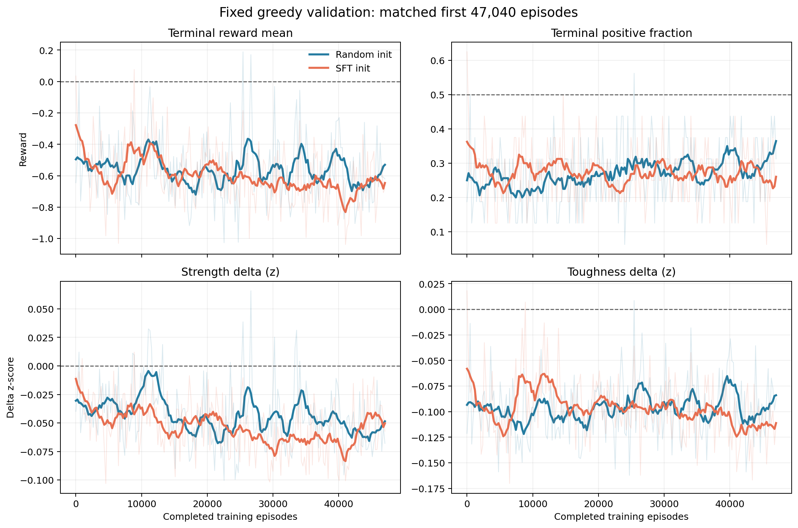
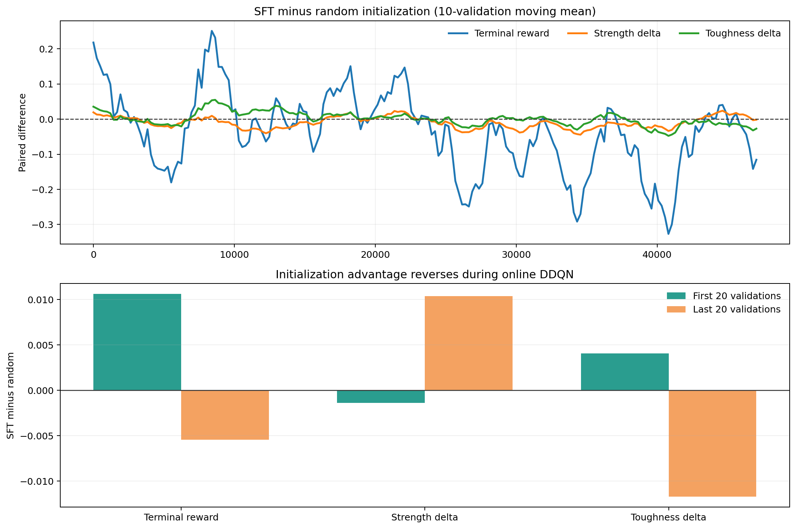
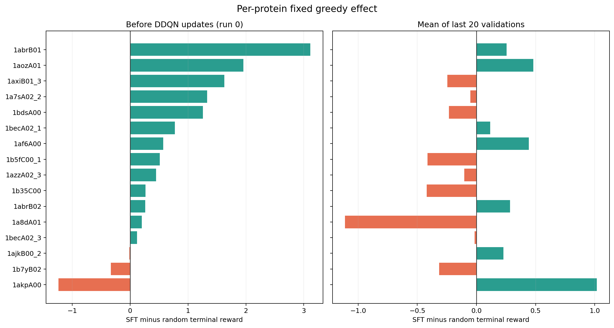
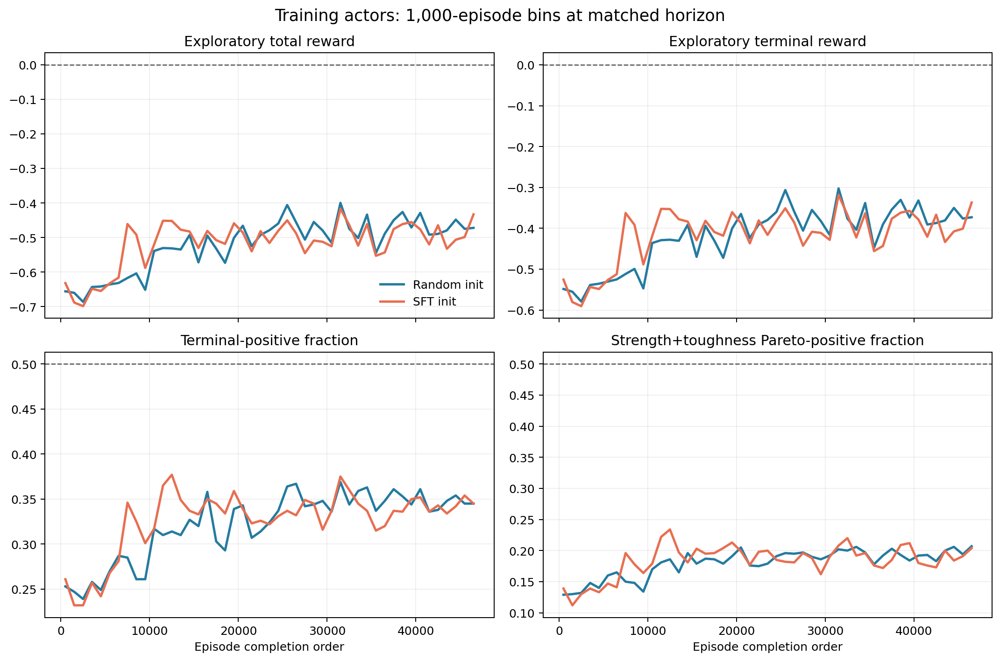
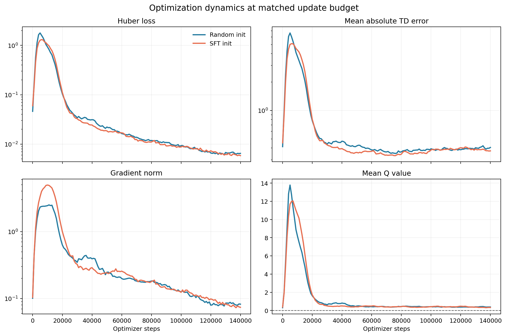

# SFT 初始化 DDQN 三天训练效果分析

**分析日期：2026-10-19**
**数据快照：47,000 个训练 episodes、197 次固定 greedy validation、140,730 次 optimizer updates**

## 一、研究背景与本次问题

本项目使用 ESM2 逐残基表示、DDQN 突变策略、PyRosetta 局部结构更新及结构力学代理模型，目标是在
未见蛋白上稳定提高 strength 与 toughness。此前通过 PER、n-step return、正向样本配额和 replay
保留等数据侧方法，使训练 reward 从“严重负值”改善为“较少负值”，但始终未可靠转正。本阶段改从
模型端入手：用 depth=0 单点突变数据监督训练 DDQN 的 MLP Q-head，再以 `best.pt` 初始化 online
与 target network，随后执行原有异步 DDQN。

本报告回答三个问题：SFT 是否学到了可迁移的动作先验；该先验是否提高在线 DDQN 的样本效率；若没有，
问题发生在 SFT 本身，还是发生在 SFT 与 RL 的衔接过程。

## 二、对照设计与证据范围

### 2.1 严格匹配的实验

SFT 实验：

```text
async_a24_esm8_f8_g1_prioritized_possample0.25_poslcb-0.25_
posreserve0.10_n3_stepx0.025_terminalx8.0_sft_20261016_121023
```

随机初始化对照：

```text
async_a24_esm8_f8_g1_prioritized_possample0.25_poslcb-0.25_
posreserve0.10_n3_stepx0.025_terminalx8.0_20260917_100006
```

两组的 seed、数据索引、24 actors、ESM2、F8/G1、batch size 128、PER、25% qualified-sample
配额、10% replay 保留、阈值 -0.25、3-step return、reward scale、epsilon schedule、learning rate
与 target-sync interval 均相同。核心差异只有 Q-head 是随机初始化还是由 SFT `best.pt` 初始化。

为避免训练时长偏差，所有主要比较均截断到共同预算：47,000 episodes、约 6.10 个等价 epoch；固定
greedy validation 比较共同的 run 0-196，即 episode 0-47,040。基线完整 64 epoch 的后期结果只作
背景参考，不与当前三天结果直接作终点比较。

### 2.2 评价层次

1. **固定 greedy validation**：16 个固定 PDB，`epsilon=0`、固定 seed，是判断策略是否真正改善的
   主要证据。
2. **训练 actor episodes**：包含 epsilon exploration，只用于观察数据收集分布，不能替代验证。
3. **优化指标**：loss、TD error、grad norm、Q value，用于判断数值稳定性和 SFT 是否被快速覆盖。
4. **逐蛋白配对分析**：避免总体均值被少量蛋白主导。

分析脚本为 `report/scripts/analyze_sft_3days.py`，完整数值保存于
`report/sft-3days-result-analysis-summary.json`。

## 三、核心结论

### 3.1 SFT 本身有效，但当前接入方式没有保留其优势

在任何 DDQN update 发生前，SFT 初始化明显优于随机初始化：

| Episode 0 固定验证指标 | Random init | SFT init | SFT - Random |
|---|---:|---:|---:|
| Terminal reward mean | -0.645 | **+0.035** | **+0.679** |
| Terminal reward median | -0.296 | **+0.111** | **+0.407** |
| Terminal positive fraction | 18.75% | **62.50%** | **+43.75 pp** |
| Strength delta mean | -0.0399 | -0.0094 | +0.0304 |
| Toughness delta mean | -0.1213 | **+0.0181** | **+0.1394** |

逐蛋白结果同样支持这一点：16 个固定蛋白中有 13 个在 SFT 初始化下获得更高 terminal reward；
平均配对增益为 `+0.679`，protein-bootstrap 95% CI 为 `[+0.219, +1.185]`。因此不能把当前结果解释为
“SFT 没有学到 reward landscape”。更准确的结论是：**depth=0 SFT 学到了可迁移的初始动作排序，
但在线 DDQN 没有保持或利用该排序。**



### 3.2 初始化优势在约 3,600 episodes 后消失

SFT 与随机初始化的 terminal reward 差值在开始阶段明显为正，但 10 次 validation 移动均值首次降到
0 以下时仅训练了约 3,600 episodes。前20次验证中，SFT 相对随机初始化的 terminal mean 优势只剩
`+0.0106`；最后20次变为 `-0.0054`。

在全部197个配对验证点上：

| 指标（SFT - Random） | 平均差值 | Moving-block 95% CI | SFT更好比例 |
|---|---:|---:|---:|
| Terminal reward mean | -0.0379 | [-0.0907, +0.0044] | 44.2% |
| Strength delta mean | **-0.00988** | **[-0.0180, -0.00349]** | 41.6% |
| Toughness delta mean | +0.00040 | [-0.00766, +0.00848] | 52.8% |

到最后20次验证，SFT 的 terminal reward mean 为 `-0.649`、positive fraction 为 `26.9%`、strength
为 `-0.0491`、toughness 为 `-0.1132`。随机初始化同期分别为 `-0.644`、`29.7%`、`-0.0594`、
`-0.1015`。两者总体相当，但 SFT 没有形成可检测的净收益。



逐蛋白层面也从“13/16改善”退化到末20次验证的“7/16改善”；末期配对差值为 `-0.0054`，95% CI
`[-0.239, +0.219]`。初始优势并非被某一两个异常蛋白夸大，而是在线更新后在整体上消失。



### 3.3 为什么 step/episode TensorBoard 看不出改善

训练 actor 使用 epsilon-greedy，epsilon 从1.0开始，在50,000 environment steps内衰减到0.05。
SFT 最有价值的早期阶段恰好被接近随机的行为策略覆盖：当 `epsilon≈1` 时，即使 greedy Q 排序很好，
实际动作仍几乎全部随机。等 epsilon 降低后，Q-head 已经经历大量来自随机探索数据的 TD 更新。

因此训练 episode 曲线几乎重合：

| 末5,000个训练 episodes | Random init | SFT init |
|---|---:|---:|
| Total reward mean | -0.473 | -0.487 |
| Terminal reward mean | -0.373 | -0.389 |
| Terminal-positive fraction | 34.60% | 34.36% |
| Pareto-positive fraction | 19.80% | 19.04% |

按 source PDB 聚合后，47k共同预算内的 SFT terminal reward 差值只有 `+0.0021`，bootstrap 95% CI
`[-0.0045, +0.0090]`；约50.1%的蛋白更好，等同随机波动。这个结果验证了用户在 TensorBoard 上的
观察，但它主要说明 **SFT 没有进入有效的数据收集闭环**，而不等于 episode 0 的 SFT policy 无效。



### 3.4 数值训练更平稳，不代表机械性能目标更好

SFT 初始化降低了主要的过估计峰值：

| 共同140,730 updates内峰值 | Random init | SFT init |
|---|---:|---:|
| Loss | 3.39 | **2.47** |
| Mean absolute TD error | 8.26 | **6.86** |
| Mean Q value | 17.11 | **14.56** |
| Grad norm | **6.19** | 14.14 |

SFT 的 grad norm 峰值和p99反而更高，表明早期 TD targets 与监督预训练参数存在较强冲突。到最后1万次
更新，两组均进入低 loss 区间；SFT 的 loss median `0.00608`、TD error median `0.380`，略低于随机
初始化的 `0.00657` 和 `0.402`。然而 greedy reward 没有改善，说明优化器只是成功拟合了在线 replay
分布，并没有保留原有的机械性能排序先验。



## 四、原因分析

### 4.1 高 epsilon 使 SFT 先验没有转化为高质量采样

当前 Plan B 只加载 SFT 权重，其余探索策略完全不变。训练一开始 epsilon=1，SFT greedy proposal
几乎不参与动作选择。随机探索产生的大量负样本先进入 replay，随后以高 TD error 获得高优先级；这使
SFT 变成“更好的初始函数”，但没有变成“更好的早期数据分布”。

### 4.2 PER 的最大 TD error 仍主要来自失败样本

两组 replay 正样本保留均约10.01%，sampled batch qualified quota 均精确为25%，说明采样机制没有
失效，也不是本次差异来源。但是 SFT 实验最后100次诊断中，priority top 1% 的 qualified fraction
只有1.34%，sampled terminal reward mean 为 `-0.287`；随机初始化同期分别为2.45%和`-0.259`。
绝对 TD-error PER 继续优先选择严重失败，在线 loss 会主动覆盖 SFT 的正动作排序。

### 4.3 SFT 与 DDQN 的监督目标并不完全相同

SFT 使用 depth=0 单点突变的 reward/LCB 标签，主要学习当前状态下的动作排序；DDQN 学习的是在
24步 horizon、step shaping、3-step bootstrapping 和未来策略共同作用下的累计 Q return。二者的
排序可能相关，但数值尺度和最优动作并不必然一致。当前直接把回归 head 当作 long-horizon Q 初始化，
没有 auxiliary ranking loss 或对初始策略的约束，TD 更新自然可以迅速改变排序。

### 4.4 depth=0 存在明显状态分布偏移

监督数据只覆盖 WT state。RL 第一次突变后就进入 SFT 从未见过的多突变状态；到第24步时偏移更大。
此外，SFT 数据中的 visited mask 基本全为0，因此与 visited-mask 对应的输入权重无法获得有效监督；
在线状态一旦出现非零 mask，这一维可能以近似随机方式影响 Q 值。这解释了“episode 0有效、连续更新后
无效”的结构性差异。

### 4.5 当前 SFT 的离线排序能力仍有限

`best.pt` 的 validation NDCG 为0.661，但 Spearman 只有0.092、greedy regret 为0.759，greedy
reward median 为0。它能提高 positive@1 命中率，却还不是精确的全动作 reward 模型。高 NDCG 与较低
Spearman 并存，说明模型主要学到粗粒度 top-action 偏好，无法稳定校准全部 Q 值。该能力足以解释
episode 0的提升，但不足以抵抗后续大量 off-policy TD updates。

## 五、对当前实验的判断

1. **SFT 方案值得保留。** Episode 0 的显著提升证明模型端预训练比单纯改变 replay 比例更接近问题
   核心。
2. **当前“仅初始化后直接DDQN”的 Plan B 没有成功。** 其样本效率在47k episodes内不优于随机初始化，
   初始优势在约3,600 episodes后消失。
3. **继续按完全相同配置长训的边际价值较低。** 随机基线曾在300k-400k episodes后出现“少负化”，
   SFT run 也可能随长训练改善，但那无法证明改善来自 SFT。若本实验目标是评价初始化收益，运行到一个
   整齐的50k checkpoint即可形成充分负结论。
4. **不能据此否定 SFT+RL。** 目前失败的是“权重初始化”这一种衔接方式，而不是 SFT 数据或动作排序
   先验本身。

## 六、下一阶段建议

### 优先级1：让 SFT 参与早期采样，而不只是初始化参数

实现 Plan D：SFT proposal 与 online-Q mixture。前期保留一定比例的 SFT greedy/top-k 动作，例如
从50%线性退火到0；剩余动作继续由 epsilon exploration 产生。这样可以检验初始正向排序能否产生更高
质量 replay。该实验应与当前 Plan B 使用相同预算和固定验证。

### 优先级2：减缓在线遗忘

对前10k-20k optimizer steps 使用较低 learning rate、短期冻结第一层，或增加退火的 auxiliary
ranking/distillation loss，使 online Q 在 depth=0 demonstration 上不立即偏离 SFT 排序。应记录
`Q_online` 与 `Q_SFT` 的 top-k overlap、Spearman 和参数距离，直接测量遗忘速度。

### 优先级3：补充 depth 1/2/4 数据

使用当前 beam-search 数据管线收集多突变状态，显式生成 visited mask，并在 state/action 层保持
positive、neutral、hard-negative 平衡。无需覆盖完整深度24；目标是降低初始几步的 covariate shift，
后续仍由 RL 探索。

### 优先级4：校准监督目标

以动作排序为主、回归为辅，考虑学习 `advantage(s,a)` 或同一 state 内中心化 reward，而不是直接把
单步 reward 当绝对 long-horizon Q。进入 RL 前应要求 sequence-cluster held-out 数据上的
positive@1、greedy regret 和 rollout reward 均显著优于随机策略。

## 七、限制

本次是单 seed 异步实验，actor 完成顺序无法逐 transition 完全复现；固定验证只有16个蛋白，置信区间
仍较宽。SFT 数据来自 RL train split，但当前 RL validation 是否在严格序列相似度 cluster 上完全隔离
仍需再次核对，因此 episode 0 的结果可视为 held-out PDB 迁移，尚不能直接称为严格 OOD 泛化。分析时
训练仍在运行，本报告固定在上述47k episode快照，后续新增日志不包含在结论中。
